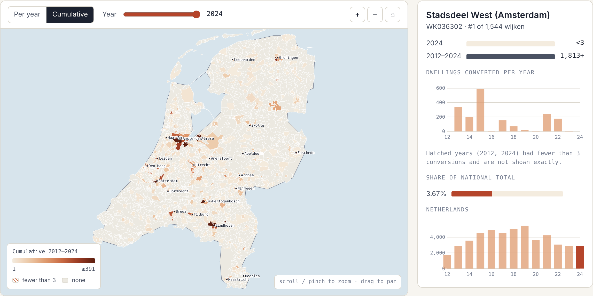

# Housing Conversion Monitor NL

[](https://NathanChen-Analyst.github.io/housing-conversion-monitor-nl/)

**Where did offices become homes?** Every dwelling created out of former office space in the Netherlands since 2012 — 49,362 of them — detected from the version history of the national building register (Kadaster BAG) and mapped per neighbourhood (wijk).

**→ Open the live map:** https://NathanChen-Analyst.github.io/housing-conversion-monitor-nl/

[](https://github.com/NathanChen-Analyst/housing-conversion-monitor-nl/actions)

---

## What the map shows

- Dwellings converted from office space per wijk, 2012–2024, as a yearly or cumulative layer
- Per-wijk time series, national rank and share of the national total
- A ranking table of the most active neighbourhoods for any year or period
- The national trend: a climb from 1,744 (2012) to a peak of 5,454 (2019), then a drop to roughly 3,000 a year

Wijk-years with one or two conversions are shown hatched and reported as "fewer than 3", following CBS practice for small cells. They are included in national totals but not located on the map.

## How conversions are detected

The BAG has no "conversion" flag. The detection reconstructs it from the full version history of every verblijfsobject (VBO): a dwelling (VBO with `woonfunctie`) that appears in a pand where office use disappeared. Each dwelling is counted once, in the year its first residential version became valid. Every dwelling is placed by coordinate into the 2012 CBS Wijk- en buurtkaart, so later municipal mergers and redrawn neighbourhoods do not break the time series.

Three patterns are implemented in [`src/hcm/conversions.py`](src/hcm/conversions.py) (use change on the VBO; new residential unit in a pand built ≥ 2 years earlier that held only non-residential units; residential units appearing after a `Verbouwing pand` status), with unit tests for the edge cases in [`tests/`](tests/).

## Data published here

| File | Content | Licence |
|---|---|---|
| `docs/data/wijk_year_conversions.json` | wijk × year counts (suppressed < 3), national series | CC BY 4.0 |
| `docs/data/wijken.geojson` | wijk boundaries, CBS 2012 vintage, simplified | CC BY 4.0 (CBS) |

Source data: Kadaster BAG (CC0), CBS Wijk- en buurtkaart 2012 (CC BY 4.0). Building-level records are not published.

If you use these numbers, cite: *Chen, N. (2026). Housing Conversion Monitor NL. https://github.com/NathanChen-Analyst/housing-conversion-monitor-nl*

## What is next

A one-year-ahead forecast of where the next conversions will happen, built on this detection plus non-residential stock, build decade and neighbouring activity. The pipeline for it (DuckDB feature table, negative-binomial GLM and LightGBM baseline, strict time split, leakage tests) is already in `src/hcm/` and `sql/`; results will be added to the map when they are validated.

## Reproduce

```bash
git clone https://github.com/NathanChen-Analyst/housing-conversion-monitor-nl
cd housing-conversion-monitor-nl
python -m venv .venv && source .venv/bin/activate
make install && make test      # 20 unit tests
```

The site in `docs/` is static and needs no build: open `docs/index.html` through any local web server. The BAG extract itself is not included (tens of GB, free from PDOK); the detection code expects the event schema documented in `src/hcm/conversions.py`.

## Repository layout

```
docs/               the site: index.html · app.js · style.css · data/
src/hcm/            conversions.py · features.py · model.py · cli.py · export_public.py · geo.py
sql/features.sql    wijk × year feature table as plain SQL
tests/              detection edge cases · leakage guard · time split
config.yaml         paths, years, spatial unit, model settings
```

## Author

Nathan Chen — PhD in housing economics; the detection method was developed for research on local housing supply and prices. Code MIT, data CC BY 4.0.
