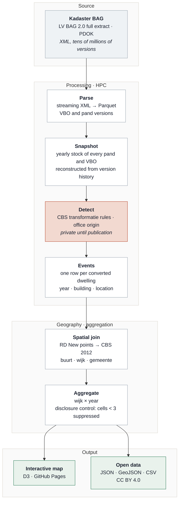

# Housing Conversion Monitor NL

[](https://NathanChen-Analyst.github.io/housing-conversion-monitor-nl/)

**Where did offices become homes?** Every dwelling created out of former office space in the Netherlands since 2012 — 49,362 of them — detected from the version history of the national building register (Kadaster BAG) and mapped per neighbourhood (wijk).

**→ Interactive map:** https://NathanChen-Analyst.github.io/housing-conversion-monitor-nl/

[](https://github.com/NathanChen-Analyst/housing-conversion-monitor-nl/actions)


 

---

## The problem

The Netherlands adds roughly ten thousand dwellings a year without building anything: offices, shops and schools are converted. Nobody publishes *where*. CBS reports national and municipal totals; developers, investors and municipalities want the neighbourhood, the year and the trend. The BAG register contains the answer, but only implicitly, scattered across tens of millions of versioned records.

This project turns that register into a neighbourhood-level, yearly, openly licensed dataset and a map anyone can read.

## Pipeline



The detector (shaded) implements the CBS definition of a *transformatie* as rule families over yearly stock snapshots, with the office origin taken from the building's own use history. It is part of a paper under review and is kept private until publication; the repository ships an illustrative three-pattern detector ([`src/hcm/conversions.py`](src/hcm/conversions.py)) so the pipeline runs and is tested end to end. The rest of the pipeline — parsing, geography, aggregation, disclosure control, export, site — is here in full. See [`docs/method.md`](docs/method.md).

The full-history extract holds tens of millions of VBO versions.

## Built with

Python 3.10+, DuckDB over Parquet for everything tabular ([`sql/`](sql/)), GeoPandas and Shapely for the point-in-polygon and boundary work ([`geo.py`](src/hcm/geo.py)), statsmodels and LightGBM for the forecast layer ([`model.py`](src/hcm/model.py)), D3 v7 for the map, pytest and ruff in GitHub Actions on two Python versions ([`tests/`](tests/), [`ci.yml`](.github/workflows/ci.yml)). The print graphic at the top is rendered from the same data files as the site ([`poster.html`](docs/poster.html)). Parse and detection steps run on a university HPC cluster; everything from the events table onward runs on a laptop in seconds.

## Data published here

| File | Content | Licence |
|---|---|---|
| `docs/data/wijk_year_conversions.json` | wijk × year counts (suppressed <3), exact national series | CC BY 4.0 |
| `docs/data/wijken.geojson` | wijk boundaries, CBS 2012 vintage, simplified 50 m | CC BY 4.0 (CBS) |

Sources: Kadaster BAG (CC0), CBS Wijk- en buurtkaart 2012 (CC BY 4.0). No building-level records are published.

Cite as: *Chen, N. (2026). Housing Conversion Monitor NL. https://github.com/NathanChen-Analyst/housing-conversion-monitor-nl*

## Validation

*Placeholder: office-derived dwellings per year against the CBS transformaties series by original use. Chart and reconciliation notes to follow.*

## Roadmap

- One-year-ahead forecast per wijk (pipeline in `src/hcm/model.py`, results pending validation)
- Province outlines on the map
- Municipal permit-to-occupancy durations from the register's own timestamps

## Reproduce

```bash
git clone https://github.com/NathanChen-Analyst/housing-conversion-monitor-nl
cd housing-conversion-monitor-nl
python -m venv .venv && source .venv/bin/activate
make install && make test
```

The site in `docs/` is static: serve the folder with any web server. The BAG extract is not included (tens of GB, free from PDOK); the events-table schema the pipeline expects is documented in `src/hcm/conversions.py`.

## Repository layout

```
docs/               site (index.html · app.js · style.css · data/) · poster.html · method.md
src/hcm/            geo · export_public · conversions · features · model · cli · config
sql/                features.sql · analysis.sql
tests/              detection edge cases · leakage guard · time split
config.yaml · Makefile · pyproject.toml · .pre-commit-config.yaml
```

## Author

Nathan Chen — PhD in economics. Code MIT, data CC BY 4.0.
