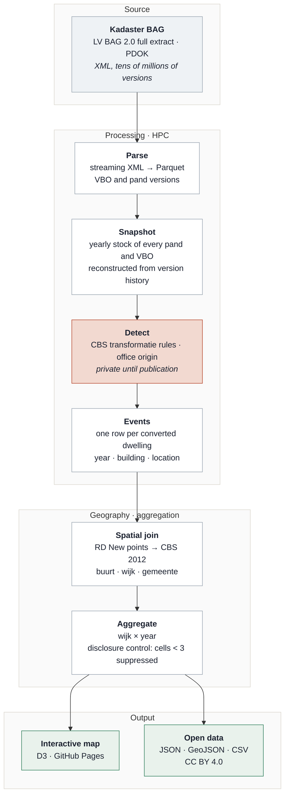

# Housing Conversion Monitor NL

[](https://NathanChen-Analyst.github.io/housing-conversion-monitor-nl/)

**Where did offices become homes?** Every dwelling created out of former office space in the Netherlands since 2012 — 49,362 of them — detected from the version history of the national building register (Kadaster BAG) and mapped per neighbourhood (wijk).

**→ Interactive map:** https://NathanChen-Analyst.github.io/housing-conversion-monitor-nl/

[](https://github.com/NathanChen-Analyst/housing-conversion-monitor-nl/actions)


 

---

## The problem

The Netherlands adds roughly ten thousand dwellings a year without building anything: offices, shops and schools are converted. Nobody publishes *where*. CBS reports national and municipal totals; developers, investors and municipalities want the neighbourhood, the year and the trend. The BAG register contains the answer, but only implicitly, scattered across tens of millions of versioned records.

This project turns that register into a neighbourhood-level, yearly, openly licensed dataset and a map anyone can read.

## Pipeline



The detector (shaded) implements the CBS definition of a *transformatie* as rule families over yearly stock snapshots, with the office origin taken from the building's own use history. It is part of a paper under review and is kept private until publication; the repository ships an illustrative three-pattern detector ([`src/hcm/conversions.py`](src/hcm/conversions.py)) so the pipeline runs and is tested end to end. The rest of the pipeline — parsing, geography, aggregation, disclosure control, export, site — is here in full. See [`docs/method.md`](docs/method.md).

The full-history extract holds tens of millions of VBO versions.

## How it is built

**Layers.** `raw/` holds PDOK deliveries untouched; `staging/` is typed Parquet, one row per BAG version (the register is a type-2 slowly changing dimension with separate validity and registration timelines); `marts/` holds yearly stock snapshots, conversion events and the published aggregates. Details and the two core as-of queries: [`docs/data-model.md`](docs/data-model.md).

**Orchestration.** A Dagster asset graph — `vbo_versions → stock_snapshots → conversion_events → events_located → wijk_year → quality_report → forecast` — with asset checks guarding the silver and publish layers and a monthly schedule matching PDOK's release cadence. Every step appends duration and row counts to `runs/runs.jsonl`.


**Incremental and idempotent.** Monthly mutation files are merged on `(id, version)`; a later registration supersedes, an identical file is a no-op, and a ledger records what was applied. [`src/hcm/mutations.py`](src/hcm/mutations.py), proven in [`tests/test_staging_mutations.py`](tests/test_staging_mutations.py).

**Data quality as code.** pandera schemas per layer, SCD2 invariants, referential integrity, grid completeness, the disclosure rule, and reconciliation against CBS with a tolerance. Errors block publishing; the report is a page: [`docs/quality.html`](https://NathanChen-Analyst.github.io/housing-conversion-monitor-nl/quality.html). [`src/hcm/quality.py`](src/hcm/quality.py).

**SQL.** dbt on DuckDB — `staging → intermediate → marts`, 21 schema tests — in [`dbt/`](dbt/); the queries behind the headline numbers in [`sql/analysis.sql`](sql/analysis.sql); the forecast feature table with time-safe joins in [`sql/features.sql`](sql/features.sql).

**Runs anywhere.** A synthetic BAG-like sample (`hcm sample`) exercises every step, so CI runs the whole pipeline on each push and `docker run hcm` does the same locally. The real extract and the production detector plug in without code changes.

| Stack | |
|---|---|
| Storage & compute | Parquet (Hive-partitioned), DuckDB; parse and detection on a university HPC cluster |
| Transformation | Python 3.10+, pandas, dbt-duckdb |
| Geospatial | GeoPandas, Shapely, RD New → WGS84 |
| Orchestration | Dagster (assets, checks, schedule) |
| Quality & tests | pandera, pytest (29), dbt tests (21), ruff, pre-commit, GitHub Actions |
| Modelling | statsmodels (NB-GLM), LightGBM (Tweedie), SHAP — forecast layer, pending |
| Delivery | D3 v7 static site on GitHub Pages, Docker image |

**At scale.** The national extract holds tens of millions of VBO versions. On a laptop, DuckDB aggregates the national events table in seconds; the parse and detection steps run on the cluster. The same code would run on BigQuery or Snowflake by pointing the dbt profile at it and partitioning `vbo_versions` by `valid_from` year.

## Data published here

| File | Content | Licence |
|---|---|---|
| `docs/data/wijk_year_conversions.json` | wijk × year counts (suppressed <3), exact national series | CC BY 4.0 |
| `docs/data/wijken.geojson` | wijk boundaries, CBS 2012 vintage, simplified 50 m | CC BY 4.0 (CBS) |

Sources: Kadaster BAG (CC0), CBS Wijk- en buurtkaart 2012 (CC BY 4.0). No building-level records are published.

Cite as: *Chen, N. (2026). Housing Conversion Monitor NL. https://github.com/NathanChen-Analyst/housing-conversion-monitor-nl*

## Validation

*Placeholder: office-derived dwellings per year against the CBS transformaties series by original use. Chart and reconciliation notes to follow.*

## Roadmap

- One-year-ahead forecast per wijk (pipeline in `src/hcm/model.py`, results pending validation)
- Province outlines on the map
- Municipal permit-to-occupancy durations from the register's own timestamps

## Reproduce

```bash
git clone https://github.com/NathanChen-Analyst/housing-conversion-monitor-nl
cd housing-conversion-monitor-nl
python -m venv .venv && source .venv/bin/activate
make install          # pip install -e ".[all]"
make test             # 29 unit tests
make sample           # synthetic BAG-like data
make pipeline         # materialise every Dagster asset
make quality          # docs/quality.html
make dbt              # dbt build: 6 models, 21 tests
make dagster          # UI at localhost:3000
```

Or: `docker build -t hcm . && docker run --rm hcm`.

The real BAG extract is not included (tens of GB, free from PDOK). Place staging Parquet in `data/staging/` with the schema in `docs/data-model.md` and the same commands run on it.

## Repository layout

```
docs/               site · poster.html · data-model.md · method.md · quality.html (generated)
src/hcm/            staging · mutations · detector · geo · export_public · quality · features · model · cli
orchestration/      Dagster definitions (assets, checks, schedule)
dbt/                dbt-duckdb project: staging → intermediate → marts, schema tests
sql/                analysis.sql · features.sql
scripts/            make_sample_data.py · make_public_data.py
tests/              29 tests: detection edge cases, SCD2 snapshots, idempotent merge, quality, leakage, time split
data/               raw/ · staging/ · marts/  (git-ignored; regenerated by `hcm sample`)
Dockerfile · Makefile · pyproject.toml · config.yaml · .pre-commit-config.yaml · CHANGELOG.md
```

## Author

Nathan Chen — PhD in economics. Code MIT, data CC BY 4.0.
