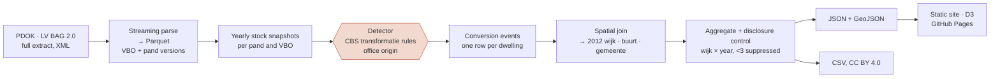

# Housing Conversion Monitor NL

[](https://NathanChen-Analyst.github.io/housing-conversion-monitor-nl/)

**Where did offices become homes?** Every dwelling created out of former office space in the Netherlands since 2012 — 49,362 of them — detected from the version history of the national building register (Kadaster BAG) and mapped per neighbourhood (wijk).

**→ Interactive map:** https://NathanChen-Analyst.github.io/housing-conversion-monitor-nl/

[](https://github.com/NathanChen-Analyst/housing-conversion-monitor-nl/actions)


 

---

## The problem

The Netherlands adds roughly ten thousand dwellings a year without building anything: offices, shops and schools are converted. Nobody publishes *where*. CBS reports national and municipal totals; developers, investors and municipalities want the neighbourhood, the year and the trend. The BAG register contains the answer, but only implicitly, scattered across tens of millions of versioned records.

This project turns that register into a neighbourhood-level, yearly, openly licensed dataset and a map anyone can read.

## Pipeline



The detector (shaded) implements the CBS definition of a *transformatie* as rule families over yearly stock snapshots, with the office origin taken from the building's own use history. It is part of a paper under review and is kept private until publication; the repository ships an illustrative three-pattern detector ([`src/hcm/conversions.py`](src/hcm/conversions.py)) so the pipeline runs and is tested end to end. The rest of the pipeline — parsing, geography, aggregation, disclosure control, export, site — is here in full. See [`docs/method.md`](docs/method.md).

Scale: the full-history extract holds tens of millions of VBO versions; the pipeline runs on a university HPC cluster for the parse and detection steps and on a laptop from the events table onward (DuckDB over Parquet, seconds for the national aggregation).

## Key engineering decisions

| Decision | Why | Where |
|---|---|---|
| One boundary vintage (CBS 2012), every dwelling assigned by coordinate | Municipal mergers and redrawn wijken would otherwise break the panel; only CBS covariates ever need a crosswalk | [`geo.py`](src/hcm/geo.py) |
| Registration date (`tijdstipRegistratie`) rather than validity date for anything a forecast may see | Municipalities back-date registrations by months; using validity dates would let a model peek at the future | [`sql/features.sql`](sql/features.sql), [`test_features.py`](tests/test_features.py) |
| One count per dwelling at its earliest qualifying version | The same VBO appears in many versions and can qualify under several rules | [`export_public.py`](src/hcm/export_public.py) |
| Small-cell suppression (<3) at publication, exact totals kept nationally | CBS convention; hides location of 9% of dwellings and none of the totals | [`export_public.py`](src/hcm/export_public.py) |
| Static site with vendored D3, data as plain JSON | Zero infrastructure, redeploys on push, works in ten years | [`docs/`](docs/) |
| Leakage test that recomputes lag features from raw events | Guards the time split against future edits of the SQL | [`features.assert_no_leakage`](src/hcm/features.py) |

## What a reviewer can inspect

| Skill | Evidence |
|---|---|
| Data engineering at national scale | Parquet + DuckDB pipeline, [`features.sql`](sql/features.sql), events-table schema in [`conversions.py`](src/hcm/conversions.py) |
| Geospatial | Point-in-polygon on RD New, dissolve and simplify for the web, [`geo.py`](src/hcm/geo.py) |
| SQL | [`sql/analysis.sql`](sql/analysis.sql): the queries behind every number above; [`sql/features.sql`](sql/features.sql): window functions, spatial lags, time-safe joins |
| Statistics / ML | NB-GLM and LightGBM-Tweedie with monotone constraints, strict time split, business metric (capture@k), [`model.py`](src/hcm/model.py) |
| Testing & CI | 20 unit tests incl. edge cases and a leakage guard, ruff, GitHub Actions on two Python versions, [`tests/`](tests/), [`ci.yml`](.github/workflows/ci.yml) |
| Disclosure control & licensing | Suppression rule, CC BY data / MIT code, provenance in every output's `meta` |
| Visualisation & communication | Interactive map with year animation and ranking, print graphic generated from the same data ([`poster.html`](docs/poster.html)) |
| Reproducibility | `make install && make test`, config in one YAML, CLI with four commands |

## Data published here

| File | Content | Licence |
|---|---|---|
| `docs/data/wijk_year_conversions.json` | wijk × year counts (suppressed <3), exact national series | CC BY 4.0 |
| `docs/data/wijken.geojson` | wijk boundaries, CBS 2012 vintage, simplified 50 m | CC BY 4.0 (CBS) |

Sources: Kadaster BAG (CC0), CBS Wijk- en buurtkaart 2012 (CC BY 4.0). No building-level records are published.

Cite as: *Chen, N. (2026). Housing Conversion Monitor NL. https://github.com/NathanChen-Analyst/housing-conversion-monitor-nl*

## Validation

*Placeholder: office-derived dwellings per year against the CBS transformaties series by original use. Chart and reconciliation notes to follow.*

## Roadmap

- One-year-ahead forecast per wijk (pipeline in `src/hcm/model.py`, results pending validation)
- Province outlines on the map
- Municipal permit-to-occupancy durations from the register's own timestamps

## Reproduce

```bash
git clone https://github.com/NathanChen-Analyst/housing-conversion-monitor-nl
cd housing-conversion-monitor-nl
python -m venv .venv && source .venv/bin/activate
make install && make test
```

The site in `docs/` is static: serve the folder with any web server. The BAG extract is not included (tens of GB, free from PDOK); the events-table schema the pipeline expects is documented in `src/hcm/conversions.py`.

## Repository layout

```
docs/               site (index.html · app.js · style.css · data/) · poster.html · method.md
src/hcm/            geo · export_public · conversions · features · model · cli · config
sql/                features.sql · analysis.sql
tests/              detection edge cases · leakage guard · time split
config.yaml · Makefile · pyproject.toml · .pre-commit-config.yaml
```

## Author

Nathan Chen — PhD in economics. Code MIT, data CC BY 4.0.
