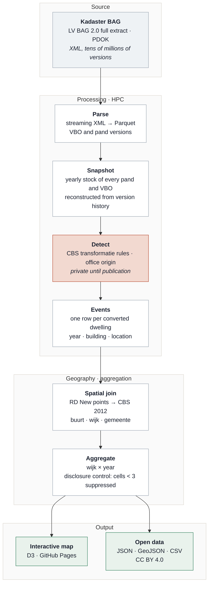
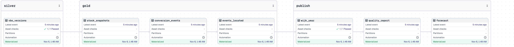

# Architecture

## Pipeline

The detector (shaded) implements the CBS definition of a *transformatie* as rule families over yearly stock snapshots, with the office origin taken from the building's own use history. It is part of a paper under review and is kept private until publication; the repository ships an illustrative three-pattern detector ([`src/hcm/conversions.py`](../src/hcm/conversions.py)) so the pipeline runs and is tested end to end. The rest of the pipeline — parsing, geography, aggregation, disclosure control, export, site — is here in full. See [`docs/method.md`](method.md).

The full-history extract holds tens of millions of VBO versions.

## How it is built

**Layers.** `raw/` holds PDOK deliveries untouched; `staging/` is typed Parquet, one row per BAG version (the register is a type-2 slowly changing dimension with separate validity and registration timelines); `marts/` holds yearly stock snapshots, conversion events and the published aggregates. Details and the two core as-of queries: [`docs/data-model.md`](data-model.md).

**Orchestration.** A Dagster asset graph — `vbo_versions → stock_snapshots → conversion_events → events_located → wijk_year → quality_report → forecast` — with asset checks guarding the silver and publish layers and a monthly schedule matching PDOK's release cadence. Every step appends duration and row counts to `runs/runs.jsonl`.

**Incremental and idempotent.** Monthly mutation files are merged on `(id, version)`; a later registration supersedes, an identical file is a no-op, and a ledger records what was applied. [`src/hcm/mutations.py`](../src/hcm/mutations.py), proven in [`tests/test_staging_mutations.py`](../tests/test_staging_mutations.py).

**Data quality as code.** pandera schemas per layer, SCD2 invariants, referential integrity, grid completeness, the disclosure rule, and reconciliation against CBS with a tolerance. Errors block publishing; the report is a page: [`docs/quality.html`](https://NathanChen-Analyst.github.io/housing-conversion-monitor-nl/quality.html). [`src/hcm/quality.py`](../src/hcm/quality.py).

**SQL.** dbt on DuckDB — `staging → intermediate → marts`, 21 schema tests — in [`dbt/`](../dbt/); the queries behind the headline numbers in [`sql/analysis.sql`](../sql/analysis.sql); the forecast feature table with time-safe joins in [`sql/features.sql`](../sql/features.sql).

**Runs anywhere.** A synthetic BAG-like sample (`hcm sample`) exercises every step, so CI runs the whole pipeline on each push and `docker run hcm` does the same locally. The real extract and the production detector plug in without code changes.

| Stack | |
|---|---|
| Storage & compute | Parquet (Hive-partitioned), DuckDB; parse and detection on a university HPC cluster |
| Transformation | Python 3.10+, pandas, dbt-duckdb |
| Geospatial | GeoPandas, Shapely, RD New → WGS84 |
| Orchestration | Dagster (assets, checks, schedule) |
| Quality & tests | pandera, pytest (29), dbt tests (21), ruff, pre-commit, GitHub Actions |
| Modelling | statsmodels (NB-GLM), LightGBM (Tweedie), SHAP — forecast layer, pending |
| Delivery | D3 v7 static site on GitHub Pages, Docker image |

**At scale.** The national extract holds tens of millions of VBO versions. On a laptop, DuckDB aggregates the national events table in seconds; the parse and detection steps run on the cluster. The same code would run on BigQuery or Snowflake by pointing the dbt profile at it and partitioning `vbo_versions` by `valid_from` year.

