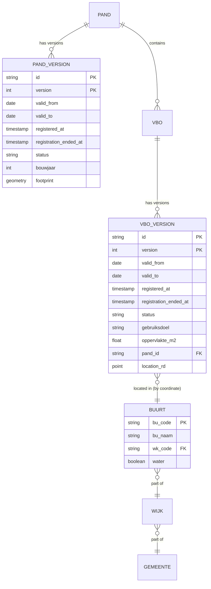

# Data model

## Source: the BAG as a slowly changing dimension

The Kadaster BAG (Basisregistratie Adressen en Gebouwen) is a national register of buildings (*pand*), accommodation objects (*verblijfsobject*, VBO) and addresses. It is delivered as a **full history**: every object has a sequence of versions (*voorkomens*), each valid for a period and registered at a moment. That makes the raw data a type-2 slowly changing dimension with two independent timelines:

| Column (BAG name) | Column (this project) | Meaning |
|---|---|---|
| `identificatie` | `id` | Stable object key (16 digits) |
| `voorkomenidentificatie` | `version` | Version number within the object, 1, 2, 3 … |
| `beginGeldigheid` | `valid_from` | When this version became true in the world |
| `eindGeldigheid` | `valid_to` | When it stopped being true (`NULL` = current) |
| `tijdstipRegistratie` | `registered_at` | When the municipality recorded it |
| `eindRegistratie` | `registration_ended_at` | When a later registration superseded it (`NULL` = latest known) |

**Validity time** answers "what was true on date *t*". **Registration time** answers "what did the register *know* on date *t*". Municipalities back-date registrations by weeks to months, so the two differ; the project uses validity time for measurement (the year a conversion happened) and registration time for anything a forecast is allowed to see (so a model never peeks).



## Layers

```
data/
├── raw/        bronze   PDOK extract and monthly mutation files, as delivered (XML in zip). Never modified.
├── staging/    silver   Typed Parquet, one row per version, partitioned by object type.
│                        vbo_versions/  pand_versions/   + mutations_applied.parquet (ledger)
└── marts/      gold     Analysis-ready tables.
                         stock_snapshots/year=YYYY/   one row per VBO alive on 1 Jan
                         conversion_events.parquet    one row per converted dwelling
                         wijk_year.parquet            aggregated, with suppression flags
```

Staging is append-only and idempotent: applying the same mutation file twice yields the same table (`hcm.mutations`). Marts are rebuilt from staging; they are cheap (DuckDB over Parquet, seconds nationally) and never hand-edited.

## The two core queries

**As-of snapshot (validity time)** — the stock of VBOs on 1 January of a year, as the world was:

```sql
SELECT *
FROM vbo_versions
WHERE valid_from <= DATE '2019-01-01'
  AND (valid_to IS NULL OR valid_to > DATE '2019-01-01')
  AND registration_ended_at IS NULL          -- latest correction of each version
QUALIFY row_number() OVER (PARTITION BY id ORDER BY version DESC) = 1;
```

**As-known snapshot (registration time)** — the same stock as the register knew it on a date, used for features a forecast may see:

```sql
SELECT *
FROM vbo_versions
WHERE registered_at <= TIMESTAMP '2019-01-01'
  AND (registration_ended_at IS NULL OR registration_ended_at > TIMESTAMP '2019-01-01')
  AND valid_from <= DATE '2019-01-01'
  AND (valid_to IS NULL OR valid_to > DATE '2019-01-01')
QUALIFY row_number() OVER (PARTITION BY id ORDER BY version DESC) = 1;
```

Both live in `hcm.staging.snapshot()` and in the dbt model `int_stock_snapshot`.

## Grain and keys

| Table | Grain | Key |
|---|---|---|
| `vbo_versions` | one BAG version of one VBO | (`id`, `version`) |
| `pand_versions` | one BAG version of one pand | (`id`, `version`) |
| `stock_snapshots` | one VBO alive at 1 Jan of a year | (`year`, `id`) |
| `conversion_events` | one converted dwelling | `id` (one event per VBO, earliest) |
| `wijk_year` | one wijk in one year | (`wijk_code`, `year`) |

## Geography

Every VBO carries an RD New (EPSG:28992) point. It is assigned once, by point-in-polygon, to the **2012** CBS Wijk- en buurtkaart. Using a single boundary vintage for all years keeps the panel stable through municipal mergers (≈ 415 → 342 municipalities over the period). Only external covariates published on later vintages need a crosswalk.

## Disclosure control

Published `wijk_year` cells with 1–2 dwellings are masked (`n = NULL`, `suppressed = true`). National and municipal totals are computed before masking and published exactly. This follows the CBS practice for small cells.
